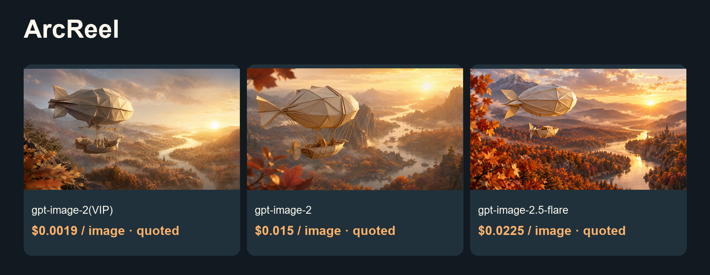

# Lower-cost ArcReel image and video guide

Turn scripts into assets, storyboards and short-video projects.

[中文](README_zh-CN.md) · [Model & pricing](https://go2v.toapis.com/1020_arc_g) · [Upstream](https://github.com/ArcReel/ArcReel)

**Independent ToAPIs community guide, not an upstream-endorsed edition.** This validates API cases and configuration/module boundaries; full upstream product acceptance is pending.

## Demo



[](examples/seedance-2.mp4)

[▶ Open the original video](examples/seedance-2.mp4)

Video parameters: seedance-2 · 480p · 4s requested / 4.04s decoded · 16:9 · generate_audio=false · first-frame I2V.

Confirmed video cost: $0.26676 / clip · $0.06602970297029702970297029703/s (this case).

## Case amounts and model rates (ascending)

2026-10-20.

| Model / preset | Type | Case amount / quote | Applicable model rate | Fee evidence |
|---|---|---:|---|---|
| gpt-image-2(VIP)<br>low / 1K | image | Quoted $0.0019 | $0.0019/image | Configured rate; task billing unavailable |
| gpt-image-2<br>1K | image | Quoted $0.015 | $0.015/image | Configured rate; task billing unavailable |
| gpt-image-2.5-flare<br>high / 1K | image | Quoted $0.0225 | $0.0225/image | Configured rate; task billing unavailable |
| seedance-2<br>480p / 4.04s / no audio | video | $0.26676 | $6.571429/1M total tokens | API billing=settled |

gpt-image-2(VIP) starts at $0.0019/image; this low/1K case is $0.0019/image. Images retain quote labels when task billing is unavailable. Three image models use the same project prompt with different quality presets. Video USD/s is a measured case ratio, not a fixed tariff.

## Project-specific reuse

1. The three integration/arcreel-gpt*.json files target ArcReel's native declarative IMAGE endpoint format. Origin is https://toapis.com (without /v1); the templates include /v1.
2. Validate and render them with integration/check-arcreel-contract.py against the pinned upstream source. The upstream validator, six render checks and three credential-placement rejection checks passed.
3. Import each definition through ArcReel's supported custom-endpoint workflow and configure the corresponding model/credential. UI import, storage and in-app generation remain untested.
4. Video case files are original independent I2V outputs. Native local-first-frame upload is still a gap: do not claim the image endpoint JSON automatically enables native video.
5. Vendor-promotion contributions are not accepted as PRs. The upstream contributing guide directs cooperation to support@arc-reel.com; no promotional Issue/PR/Discussion was posted.

## Run the independent API cases

```powershell
$env:TOAPIS_API_KEY="your_private_key"
python run_case.py --job jobs/gpt-image-2-vip.json
python run_case.py --job jobs/gpt-image-2-vip.json --live
python run_case.py --job jobs/video.json
python run_case.py --job jobs/video.json --live
```

Without --live, only the current key rate is queried. Set a budget locally; the recipe enforces per-request caps, not a hosted-account global spend limit. After errors/timeouts, reconcile the saved task before another submission.

## Optional synchronous compatibility bridge

```powershell
$env:BRIDGE_TOKEN="replace_with_a_separate_random_token_at_least_24_chars"
$env:BRIDGE_PORT="8769"
python bridge.py
```

Binds to 127.0.0.1 only. UI credentials use the separate bridge token. Keep the real generation key in the bridge environment. Preserve upstream outbound/SSRF rules; this is not a public hosted-service endpoint. Image edits are not enabled.

## Original inputs and outputs

```text
An original cinematic storyboard still: a small handmade ivory origami airship floats above an autumn valley, copper leaves and winding river below, golden sunrise, intricate paper folds and soft volumetric light, whimsical film production design, clear single composition, 16:9 landscape, no text, no logos, no watermark.
```

[Jobs](jobs/) · [Original media](examples/) · [Sanitized evidence](evidence/) · [Acceptance](ACCEPTANCE.md) · [Upstream and protocol evidence](UPSTREAM.md)

## License and scope

Original guide/adapter code: MIT. Upstream source and trademarks keep their own license and ownership. The OpenShorts fork retains its upstream MIT license. No existing sponsor/referral links were replaced. No audio integration claim is made.
