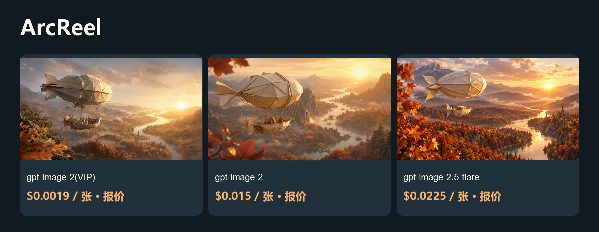

# 更低成本的 ArcReel 图片与视频方案

把剧本拆成资产、分镜与短视频项目。

[English](README.md) · [Model & pricing](https://go2v.toapis.com/1020_arc_g) · [Upstream](https://github.com/ArcReel/ArcReel)

**ToAPIs独立社区方案，非上游官方版本。** 本轮验证API、配置契约或局部Adapter，完整产品流程尚未验收。

## 演示



[](examples/seedance-2.mp4)

[▶ 查看真实视频](examples/seedance-2.mp4)

视频参数：seedance-2 · 480p · 4s requested / 4.04s decoded · 16:9 · generate_audio=false · first-frame I2V.

视频实际消费：$0.26676 / clip · $0.06602970297029702970297029703/s (this case).

## 本例花费与模型价格（升序）

2026-10-20.

| 模型／档位 | 类型 | 本例金额／报价 | 对应模型价格 | 费用依据 |
|---|---|---:|---|---|
| gpt-image-2(VIP)<br>low / 1K | 图片 | 报价 $0.0019 | $0.0019/image | 档位报价；单任务未返回结算 |
| gpt-image-2<br>1K | 图片 | 报价 $0.015 | $0.015/image | 档位报价；单任务未返回结算 |
| gpt-image-2.5-flare<br>high / 1K | 图片 | 报价 $0.0225 | $0.0225/image | 档位报价；单任务未返回结算 |
| seedance-2<br>480p / 4.04s / 无声 | 视频 | $0.26676 | $6.571429/1M total tokens | API billing=settled |

gpt-image-2(VIP)通用价格为$0.0019/image起；本例low/1K为$0.0019/image。图片按当期同Key档位报价标识，未把缺失回执写成实扣。三模型使用本项目相同提示词，但质量档位不同，不能视为同等质量比较。视频美元/秒是本例折算，不是固定秒价。

## 对应项目的复用方法

1. 3份integration/arcreel-gpt*.json对应ArcReel原生声明式图片端点。地址用https://toapis.com（不带/v1），模板自身含/v1。
2. 使用integration/check-arcreel-contract.py对照固定上游源码校验；原生校验、6项请求渲染和3项凭据位置反例均通过。
3. 通过产品支持的自定义端点流程导入定义、配置模型及凭据；界面导入、持久化与产品内生成尚未验收。
4. 视频为独立真实图生视频案例；本地首帧如何原生上传仍需适配，图片JSON不代表原生视频已接通。
5. 上游不接受推广类接入PR，贡献指南指定support@arc-reel.com谈合作；本轮没有在其Issue/PR/Discussion发布商业推介。

## 运行独立API案例

```powershell
$env:TOAPIS_API_KEY="your_private_key"
python run_case.py --job jobs/gpt-image-2-vip.json
python run_case.py --job jobs/gpt-image-2-vip.json --live
python run_case.py --job jobs/video.json
python run_case.py --job jobs/video.json --live
```

不加--live仅查当前Key价格。先在本地设置预算；脚本提供单任务限额，不代表托管账户全局消费限制。失败或超时先查保存的原任务，不重复提交。

## 可选同步桥接

```powershell
$env:BRIDGE_TOKEN="replace_with_a_separate_random_token_at_least_24_chars"
$env:BRIDGE_PORT="8769"
python bridge.py
```

只监听127.0.0.1；界面填独立桥接Token，不填写真实ToAPIs Key。不改变上游SSRF/出站策略，不用于公共托管服务。图片仅文生图；视频桥只支持明确的首帧、尺寸与4秒档位。

## 原创输入与输出

```text
An original cinematic storyboard still: a small handmade ivory origami airship floats above an autumn valley, copper leaves and winding river below, golden sunrise, intricate paper folds and soft volumetric light, whimsical film production design, clear single composition, 16:9 landscape, no text, no logos, no watermark.
```

[Jobs](jobs/) · [Original media](examples/) · [Sanitized evidence](evidence/) · [Acceptance](ACCEPTANCE.md) · [Upstream and protocol evidence](UPSTREAM.md)

## 许可与边界

Original guide/adapter code: MIT. Upstream source and trademarks keep their own license and ownership. The OpenShorts fork retains its upstream MIT license. No existing sponsor/referral links were replaced. No audio integration claim is made.
